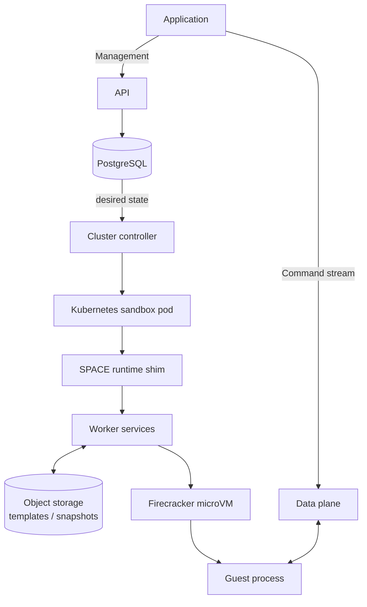

# SPACE: Architecture

[Documentation](../README.md)

A sandbox, a lifecycle operation, and a command stream have separate lifetimes. A sandbox can outlive both the request that created it and the connection carrying its output.

## Core concepts

| Concept | Meaning |
|---|---|
| Template | The starting filesystem and runtime configuration. Many sandboxes can use the same template without changing it. |
| Sandbox | An isolated microVM with its own writable filesystem and lifecycle. |
| Process | A program executing inside a sandbox. Processes in the same sandbox share its environment and filesystem. |
| Command session | Connection information and authorization for one command. Creating the session assigns a process ID; attaching starts the process. |
| Operation | A record tracking an asynchronous create, pause, suspend, wake, or delete request. |

A template reference such as `seed:latest` selects a published release; a digest reference selects specific content. A sandbox response reports the resolved template digest so callers can record what they ran.

Operators can restrict newly registered template artifacts with
`SPACE_TRUSTED_TEMPLATE_STORAGE_BUCKETS` on the internal API: a comma-separated
list of exact S3 bucket names. A configured policy rejects other buckets and
all endpoint overrides before writing the release or its tags. An unset or
empty policy preserves local S3-compatible storage. This policy does not audit
existing releases or replace publisher authorization; provision the allowlist
before promoting an enforcement image.

## Request and execution flow

The API records desired state in PostgreSQL. Controllers and worker services reconcile the running system with that state, so an accepted request is not a readiness signal.

SPACE can manage workers directly or through Kubernetes. The [direct adapter](../crates/libs/api/src/controllers/substrate/direct.rs) calls worker services without creating Kubernetes sandbox pods. The [Kubernetes adapter](../crates/libs/api/src/controllers/substrate/kubernetes/mod.rs) is used by the local Kind installation in these guides.

### Local Kind topology

The diagram below shows the Kind deployment used in these guides, not a requirement for every SPACE deployment.

<p class="diagram-scroll-hint">Scroll horizontally to view the full diagram.</p>



<details class="diagram-description">
<summary>Diagram text description</summary>

Management follows **Application → API → PostgreSQL**. Desired state flows from
**PostgreSQL → Cluster controller → Kubernetes sandbox pod → SPACE runtime shim
→ Worker services → Firecracker microVM → Guest process**. Worker services
exchange **templates/snapshots** with **Object storage** in both directions.
The separate command-stream path is **Application → Data plane ↔ Guest process**.

</details>

- **Create:** The API resolves the template and accepts the requested sandbox. The client retains the sandbox ID and operation ID.
- **Become ready:** Controllers arrange execution through the selected adapter and worker services. In Kind, this includes Kubernetes sandbox pods and the runtime shim. The client waits for operation success, a `running` sandbox, and a reachable process endpoint.
- **Execute:** The API creates a command session. The client attaches to the returned events endpoint, starting the guest process and receiving output.
- **Finish:** The client checks the process exit result, then keeps the sandbox for another command or deletes it. A completed command does not itself delete the sandbox.

An operation's `state` describes the lifecycle request; the sandbox's `state` describes the environment. Neither is the exit status of a command.

In Kind, sandbox pods run in their own namespace, `sandboxes`, apart from the control plane in `space`. NetworkPolicies there admit only the API and cluster controller, on the port they dial, and limit sandbox egress to the public IPv4 internet and cluster DNS; the [Kind harness README](../infra/space/kind/README.md#sandbox-namespace-and-network-policy) lists each rule's source.

## Lifecycle and persistence

[Snapshot upload streaming](snapshot-upload-streaming.md) describes the worker
transfer pipeline, memory bounds, failure ownership, and rollout behavior.

Pause and suspend both stop execution, but retain state differently. Use wake to return a paused or suspended sandbox to running, and wait for its operation and readiness before issuing another command.

| State | Process execution | What is retained | Next action |
|---|---|---|---|
| Running | Processes can execute. | Live VM memory and writable filesystem. | Run more commands, pause, suspend, or delete. |
| Paused | Execution is paused. | VM memory remains resident and the filesystem remains on the worker. This is not a durable snapshot. | Wake to resume. |
| Suspended | No guest execution. | A snapshot of VM memory, runtime state, and root filesystem; active VM resources are released. | Wake to restore. |
| Deleted | No execution. | The sandbox is no longer available through the API. | Create another sandbox if needed. |

The stored vCPU shape is the sandbox's activation allocation. A live CPU update
changes the current execution's scheduling quota within its admitted ceiling;
it does not resize the guest or replace that stored shape. Pause/resume keeps
the live quota. A new start or restore returns to the activation allocation,
so a temporary reduction does not permanently prevent raising the quota again.

By default, sandboxes created through the SPACE API suspend after six hours without access or command activity. This is an idle limit, not a maximum lifetime.

A created or overwritten file that can replace its destination is published
atomically when its writes complete, and persisted at lifecycle boundaries,
not per write: an acknowledged one is not guaranteed to survive a sandbox
crash, forced stop or host failure. [Guest file and disk
I/O](space/design/guest-io.md) describes the guest's disk, its per-sandbox
limits, the upload and read paths, and what each lifecycle operation persists.

The **E2B Compatibility Wrapper (ECW)** is SPACE's E2B-compatible API surface.
It translates E2B-compatible requests and responses at the edge and is distinct
from the SPACE API. The [ECW guide](ecw.md) defines its tested compatibility
contract and configuration. ECW uses different lifecycle names: its pause maps
to SPACE suspend, and its resume maps to SPACE restore.

Service-port ingress has a separate connection lifetime. With ingress protection
enabled and completion framing negotiated, automatic lifecycle transitions defer until the HTTP response body or
WebSocket connection completes; explicit lifecycle operations retain their
existing authority. Ingress wake authorizes access and respects the
sandbox's access-wake policy before preparing a dormant backend. Route resolution
first prepares the current worker path. If activation or recovery is needed,
the cluster API delegates through the authenticated `IngressActivationApi` to
the API process's existing lifecycle controller. It re-resolves and reauthorizes
after activation, within the original request deadline. The cluster API does
not construct a Kubernetes substrate or retain the sandbox-pod reflector cache.
Accepted activation remains owned by the API's tracked lifecycle tasks and
existing execution leases; a caller timeout only ends its wait. Transport idle
limits still apply, and SPACE does not generate WebSocket keepalives.
During coordinated deployment, a temporary metadata opt-in falls back to ordinary
stream termination for older callers or gateways. Drain existing attachments
before rollback; old decoding forwarders are not a supported steady state. The
internal API retains explicit loopback preparation until all workers provide
attachment readiness. Fallback connections do not provide full downstream
lifetime protection, so retain caller renewals. Remove this metadata opt-in and
the fallback branches after deployment is complete. Reconnect deadline updates require a
specific worker response-metadata acknowledgement; ordinary touch success cannot
stand in for a successful extension. Reconnect extends a deadline floor, not
the configured idle window; changing that window requires an explicit timeout
update. When API identity publication lags, deadline operations obtain the
current execution generation from the worker before applying a fenced mutation.
This lookup remains necessary after rollout; missing API identity is not proof
of a dormant execution. Ingress protection does not cover unrelated background
operations.
Accepted ingress activation survives request cancellation. The API's HTTP and
activation listeners share its shutdown signal and drain budget. Draining is
best-effort within the deployment termination grace; existing activation leases
provide recovery if the process exits before completion.

### Lifecycle policy at activation

Timeout updates use durable execution ownership rather than a lifecycle label
alone. A Kubernetes sandbox can retain lifecycle `started` after its execution
has retired and placement has cleared. With no execution, activation lease,
route, or node assignment, the policy update succeeds without waking it.
Direct-mode missing placement does not provide the same proof of absence.

The next activation reads policy after claiming execution ownership. Start
(including snapshot restore), Wake, and resident Resume can carry that policy
to the worker. The worker installs it atomically with activation admission,
after snapshot materialization and before arming inactivity timers. Omission
preserves the worker policy; local overrides remain authoritative. Retrying an
already-running activation does not replace its policy or reset its deadline.

Resident policy updates compare the observed execution generation atomically
with resume admission. An absent generation matches only a legacy resident
that still has none. Wake carries this resume fence separately from fresh
activation authority. If the resident retires after observation, Wake requests
a fresh identity through the normal activation handshake. A fence without
policy is invalid; policy omission preserves legacy behavior without a resume
fence. Capability checks use the resolved runtime connection rather than
asynchronous placement observations.

An identified execution still starting may be observed within the original
operation deadline before a timeout reset is sent. Observation does not start
another execution or retarget a replacement generation. The reset is sent once:
an ambiguous transport failure does not establish that repeating a clock reset
is safe.

## Service responsibilities

| Component | Responsibility |
|---|---|
| API and PostgreSQL | Authenticate and authorize requests; store control-plane records and desired state. |
| Controllers and adapters | Coordinate sandbox lifecycle changes with worker services. In Kind, the Kubernetes adapter, cluster controller, and runtime shim create and manage sandbox pods. |
| Worker services | Manage VMs, networking, volumes, templates, and credentials. btrfs copy-on-write supports root filesystem creation. |
| Data plane | Connect clients to guest processes and forward events using scoped tokens. |
| Builders and object storage | Build templates separately from user sandboxes and store template and snapshot artifacts. The Kind deployment uses Versity S3 Gateway (versitygw). |
| Internal API and UI | Support node registration and template-release publication, and provide a browser interface. API clients do not require the UI. |

Sandbox-manager waits for node-manager before advertising takeover readiness
and again before acquiring the startup-recovery work gate. Temporary dependency
failures keep the process waiting with bounded individual attempts and periodic
warnings; there is no overall dependency-wait deadline. Its optional local health
socket serves liveness while withholding readiness during these waits. Deployment
probes must distinguish liveness from readiness; external startup deadlines still
apply. Local execution-authority validation remains under recovery admission.
These availability checks do not guarantee that node-manager will stay available
through recovery, and do not extend any caller's request deadline.

Existing namespace containment runs with at most four workers, preserving the
order of checks within each namespace. All checks finish before admission;
any failure prevents activation. Shutdown stops scheduling new namespaces and
waits for in-flight host commands before releasing service ownership. The pool
opens on tracked blocking work so its host commands do not stall local liveness.

An opt-in Linux benchmark exercises production containment against synthetic
network namespaces and nftables rules, comparing sequential and bounded parallel
passes. Run only inside a disposable container with network namespace capabilities:

```sh
SPACE_RUN_CONTAINMENT_BENCHMARK=1 cargo test -p pplx-space-node-mgr --lib \
  linux_containment_benchmark -- --ignored --nocapture
```

## Security boundaries

Firecracker isolates guest execution. Host-side services still require privileges to manage VMs, storage, and networking.

The API authorizes management requests with a user-session or service bearer token. The data plane authorizes command connections with session-scoped attachment tokens. Management and attachment tokens are not interchangeable.

Continue with [Your first sandbox](first-sandbox.md) for API examples and [recovery steps](first-sandbox.md#troubleshoot-failures).

Internal TCP transport configuration and coordinated rollout requirements are
documented in [Internal RPC TLS](internal-rpc-tls.md).

### Sandbox artifact transfer administration

Node-api exposes no sandbox or snapshot transfer RPCs to remote callers.
Template transfer remains available through its existing API.

Sandbox and snapshot export/import remain available through the sandbox-manager
Unix socket to root or an account with the local operator role. No transfer
command is shipped in the `sbx` CLI. Performing a transfer requires custom code
using the sandbox-manager client library: `ExportSandbox` / `ExportSnapshot` on
the source and `ImportSandbox` / `ImportSnapshot` on the destination. That code
must supply the destination RPC's existing import header and file chunks.
Source lifecycle, encryption restrictions, and destination validation still
apply. The node-api service account cannot invoke these local artifact methods.

## TLS interception exemptions

`NetworkPolicyV1.tls_interception_exemptions` uses the same destination selectors
as egress rules. After normal destination admission, the gateway relays matching
SNI hostnames or destination IPs without terminating TLS, even when
`tls_interception` is `on`. A new connection using a hostname exemption requires
a live observed DNS binding from that hostname to the destination IP, including
under default-allow or independent IP allowances. Without that binding, normal
interception applies.
IP exemptions also support TLS without SNI and apply regardless of the hostname
served at that IP. Domain-only egress allowances still require the guest's DNS
attribution and matching SNI.
Explicit destination denies and platform guardrails take precedence. Exemptions
grant no egress permission and bypass HTTP inspection and credential injection.
Other destinations retain the policy's interception mode.

With `tls_interception` `on`, a connection whose guest sends nothing is normally
closed, because interception needs the ClientHello's SNI. If the destination
was admitted without DNS evidence (an IP or CIDR allow, or a default-allow
policy), the gateway first dials it and waits up to 10 seconds for either side
to speak. If the destination speaks first, as FTP, SMTP, POP3 and IMAP servers
do, the connection is relayed without interception, so a later `STARTTLS` is
not inspected. If the guest speaks first, its bytes are admitted as usual; a
plain relay of them reuses the probe connection, so a destination that accepts
one connection, such as an FTP passive data port, still receives them.
Destinations admitted only by a domain allow still close a silent connection.

The API composes [operator egress profiles](egress-profiles.md) into the tenant's
policy on authenticated federated creates. A profile independently supplies
allowances and TLS exemptions. DNS resolver allowances are not exempted.
Selected names are persisted separately from the effective policy. Fresh creates,
policy replacement, and explicit template inheritance resolve current definitions.
Forks retain the selected names and saved effective policy; resume and restart do
not refresh profile destinations.
An established exempt flow retains its verified hostname binding for its lifetime,
so DNS expiry or cache eviction does not disconnect it on an unrelated policy
update. Each update still rechecks current egress permissions and exemptions;
removing an exemption closes the flow when the updated policy requires interception.
New connections require fresh DNS evidence.

Before configuring nonempty profile exemptions, upgrade every policy reader and
running gateway to support TLS exemptions. Native sandbox and template policy
writers must observe the same reader compatibility requirement. Upgrade queued
operation executors before APIs begin admitting profile selections.

Before downgrading a reader, remove exemptions from stored policies and operator
profile selections using compatible binaries, or retire the affected resources.
Disabling configuration does not strip an existing sandbox's profile selection.
Removing an exemption restores interception, so pinned clients need an
appropriate operational fallback before rollback.
