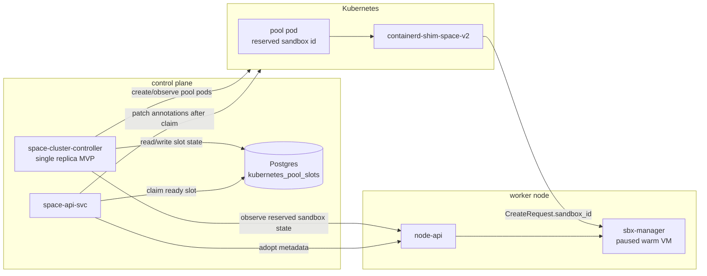
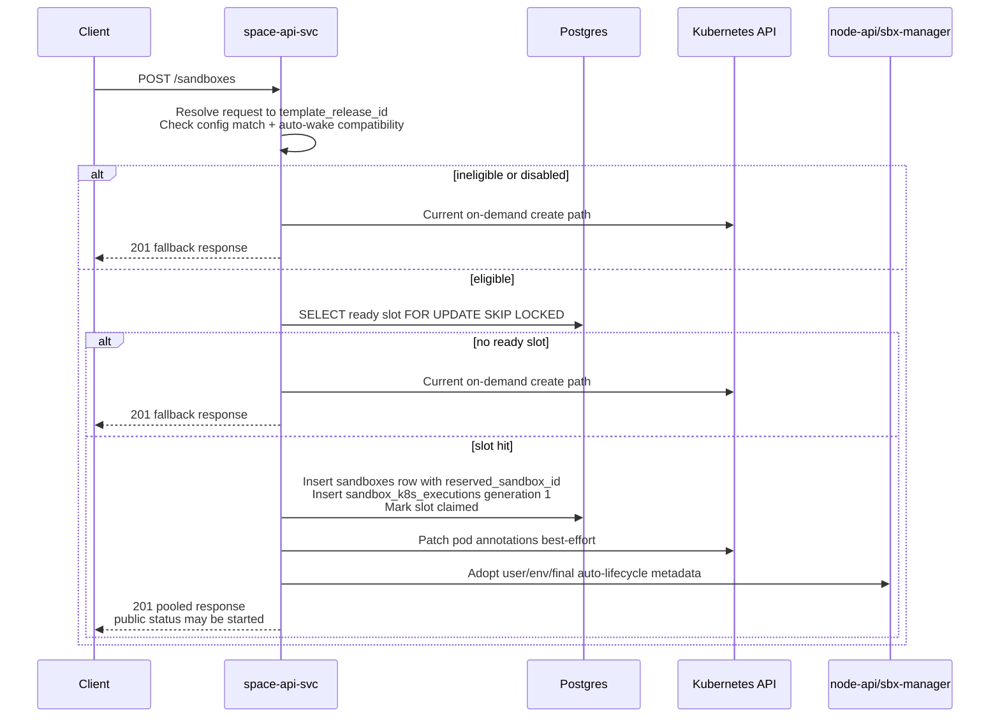
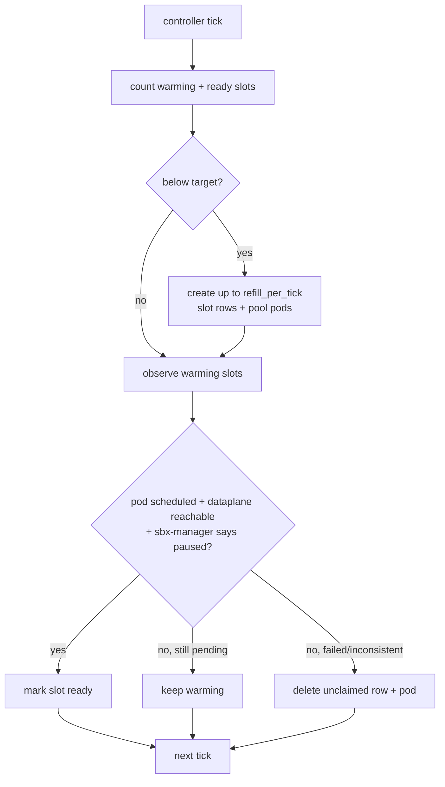

# RFC: Cluster-wide sandbox pool

Date: May 1, 2026

Author: Nick Dujay

Status: implemented and extended. This is the original design record. For how
to configure and use warm pools today, see
[Warm pools and base snapshots](../../warm-pools.md). Later work added rolling
warm-pool policies, admission-time claims for native creates, encryption-aware
pools and additional slot states; the metric names below were also replaced by
the `warm_pool.*` metrics in that guide.

## Problem

SPACE Kubernetes sandbox create still pays too much setup cost on the request path: pod creation, scheduling, CNI/IP propagation, shim startup, node-local VM work, and proxy readiness. Traced creates took seconds, well above the sub-second create latency that hosted sandbox services offer.

This RFC proposes a small MVP to prove one hypothesis: **if a pod and paused warm VM already exist before demand, API create can become a fast claim instead of a full Kubernetes startup path.**

The pool is an optimization only. On any miss or unsafe condition, create falls back to the current on-demand Kubernetes path.

## MVP Scope

Build one configured Kubernetes pool slice, not the full pool platform.

The slice is configured by an admin-editable pool config row. The important key is an existing `template_releases.id`, not a new free-form template/hash identity:

```
template_release_id
vcpu
memory_mib
target_ready_slots
refill_per_tick
max_warming_slots
namespace
enabled
```

The API still accepts template names/tags/content hashes at the public boundary, but it resolves those to a concrete `template_releases` row before checking pool eligibility.

MVP deliberately skips:

- autosizing
- org partitioning
- decision/event history tables
- multi-replica controller / leader election
- drain, quarantine, and rich emergency workflows

MVP includes a minimal admin surface to create, disable, and update pool config rows. It does not need the full policy engine yet.

The only goal is to measure whether ready paused pods materially reduce create latency.

## Architecture

The MVP has two paths: a background controller path that keeps one slice warm, and a request path that either claims a ready slot or falls back on-demand.



## Pool Slot Contract

A pool slot is a precreated Kubernetes pod backed by a node-local paused VM.

The controller reads a pool config row, joins it to `template_releases`, and generates a future `reserved_sandbox_id` before creating the pod. The pod carries the resolved release details as annotations because the shim and sandbox-manager still need the template name and content hash:

```yaml
space.pplx.net/pod-role: pool
space.pplx.net/pool-config-id: <pool-config-id>
space.pplx.net/pool-slot-id: <slot-id>
space.pplx.net/template-release-id: <template-release-id>
space.pplx.net/template: <template-name>
space.pplx.net/content-hash: <template-release-hash>
space.pplx.net/sandbox-id: <reserved-sandbox-id>
```

The existing shim path reads `space.pplx.net/sandbox-id` from OCI annotations and forwards it to sandbox-manager as `CreateRequest.sandbox_id`. That means the controller can choose the sandbox id up front; the control plane does not need to query node-local services to discover it later.

A slot is `ready` only when:

- the pod exists and is scheduled
- pod IP/dataplane is reachable
- shim has created the reserved sandbox id
- sbx-manager reports that sandbox as a paused warm VM
- template/content hash/vCPU/memory match the configured slice
- the node is not cordoned

## Data Model

One table:

```
kubernetes_pool_slots
- id UUID PRIMARY KEY
- reserved_sandbox_id UUID NOT NULL UNIQUE
- template_name TEXT NOT NULL
- content_hash TEXT NOT NULL
- vcpu INT NOT NULL
- memory_mib INT NOT NULL
- pod_name TEXT NOT NULL
- pod_namespace TEXT NOT NULL
- pod_uid TEXT nullable
- pod_ip INET nullable
- k8s_node_name TEXT nullable
- state TEXT NOT NULL              # warming | ready | claimed
- claim_id UUID nullable
- ready_at TIMESTAMPTZ nullable
- claimed_at TIMESTAMPTZ nullable
- created_at TIMESTAMPTZ NOT NULL
- updated_at TIMESTAMPTZ NOT NULL
```

State transitions:

```
warming -> ready      controller observes pod + node-local paused VM
ready   -> claimed    API atomically claims the slot during create
failure -> delete      controller deletes unclaimed bad row/pod and refills later
```

`claimed` rows are tombstones/debug records. They are no longer pool inventory.

## Create Path



Claim transaction:

```sql
SELECT s.id, s.reserved_sandbox_id, s.pod_name, s.pod_namespace, s.pod_uid, s.pod_ip, s.k8s_node_name
FROM kubernetes_pool_slots s
JOIN kubernetes_pool_configs c ON c.id = s.config_id
WHERE s.state = 'ready'
  AND c.enabled = true
  AND s.template_release_id = $1
  AND s.vcpu = $2
  AND s.memory_mib = $3
ORDER BY s.ready_at ASC
FOR UPDATE SKIP LOCKED
LIMIT 1;
```

In the same transaction, API:

- inserts `sandboxes(id = reserved_sandbox_id, ...)`
- inserts `sandbox_k8s_executions` generation `1` for the existing pod
- marks the slot `claimed`

After commit, API patches pod annotations and calls node-local adoption to apply user/env/final auto-lifecycle metadata. Node-local services do not query Kubernetes.

Internal runtime state remains truthful: the VM may be `paused`. Public create can report `started` for compatibility because the next command/access auto-wakes through sbx-manager. That requires an auto-lifecycle policy compatible with command/access wake; otherwise the request is ineligible and falls back on-demand.

## Controller Loop

Single controller replica for MVP.



Every few seconds:

```
current = count(slots where state in ('warming', 'ready'))
to_create = min(target_ready_slots - current, refill_per_tick, max_warming_slots - warming_count)
create to_create new slot rows and pods
observe warming slots and mark ready when pod + node-local paused VM are ready
delete unclaimed failed/inconsistent slots and pods
```

The controller must rate-limit pod creation and node-api polling. It must not flood Kubernetes with speculative Pending pods. If the cluster cannot schedule pool pods, it backs off and user creates continue through on-demand fallback.

## Failure Rules

MVP keeps failure handling intentionally boring:

- **No ready slot:** fallback on-demand.
- **Request does not exactly match configured slice:** fallback on-demand.
- **Auto-wake policy is incompatible:** fallback on-demand.
- **Unclaimed slot/pod is inconsistent:** delete row and pod; refill later.
- **Pod disappears before claim:** delete row; refill later.
- **Claim transaction loses race:** fallback on-demand or retry once within a tiny budget.
- **Post-claim annotation/adoption fails:** fail that sandbox or let normal sandbox recovery handle it; do not return the slot to the pool.

This is less elegant than a full claim/adopt/bind recovery state machine, but it is enough to prove the latency hypothesis.

## Observability

Minimum metrics:

- `sandbox.pool.claim.latency_ms`
- `sandbox.pool.decision` tagged `decision:hit|miss_no_slot|miss_ineligible|fallback_error`
- `sandbox.pool.slot.count` tagged `state:warming|ready|claimed`
- `sandbox.pool.slot.ready_latency_ms`
- `sandbox.pool.slot.error` tagged by reason
- `sandbox.api.create.latency_ms` tagged `pooled:true|false`

Minimum spans:

- pool eligibility
- slot claim transaction
- pod annotation patch
- node-local adoption
- fallback path

The MVP succeeds only if pooled creates are materially faster than on-demand creates and miss/failure rates are easy to explain from metrics.

## Design Constraints

- Warm slots can serve any matching sandbox until claimed. Once claimed, they become dirty and leave the pool.
- Pool eligibility is keyed by a concrete `template_releases.id` plus resource shape, not by a loose template string.
- No matching config and no ready slot both fall back on-demand, but they emit different metric decisions.
- Kubernetes remains the production focus; direct substrate is out of scope for MVP.
- On-demand create remains the correctness path.
- State ownership is simple: controller owns `warming -> ready`, API owns `ready -> claimed`, node-local services do not write pool rows.
- The controller is constrained by explicit target/refill limits so it does not overwhelm Kubernetes.

## Workstream

This is a small multi-PR experiment, roughly **1-2 weeks** with one human steering and agents implementing slices:

1. Migrations for pool configs/slots and shared slot helpers.
2. Minimal admin UI/API to create and update a pool config from existing template releases.
3. Controller loop that creates/observes ready slots.
4. API claim/fallback path.
5. Minimal node-local adoption hardening.
6. Metrics/traces and one dashboard.

Critical path: node-local adoption, API claim transaction correctness, and controller readiness observation.

## Deferred Until After MVP

If the MVP proves the latency hypothesis, then revisit:

- `sandbox_pool_policies`
- `sandbox_pool_decisions`
- slot event history
- autosizing and materialized slices
- org partitioning
- admin UI
- leader election / HA controller
- drain/quarantine/recovery workflows
- priority/preemption strategy

## Recommendation

Build the MVP as a controlled experiment. Do not build the full cluster-wide pool platform until the MVP proves that ready paused pods move create latency close enough to that sub-second target to justify the added operational surface.
