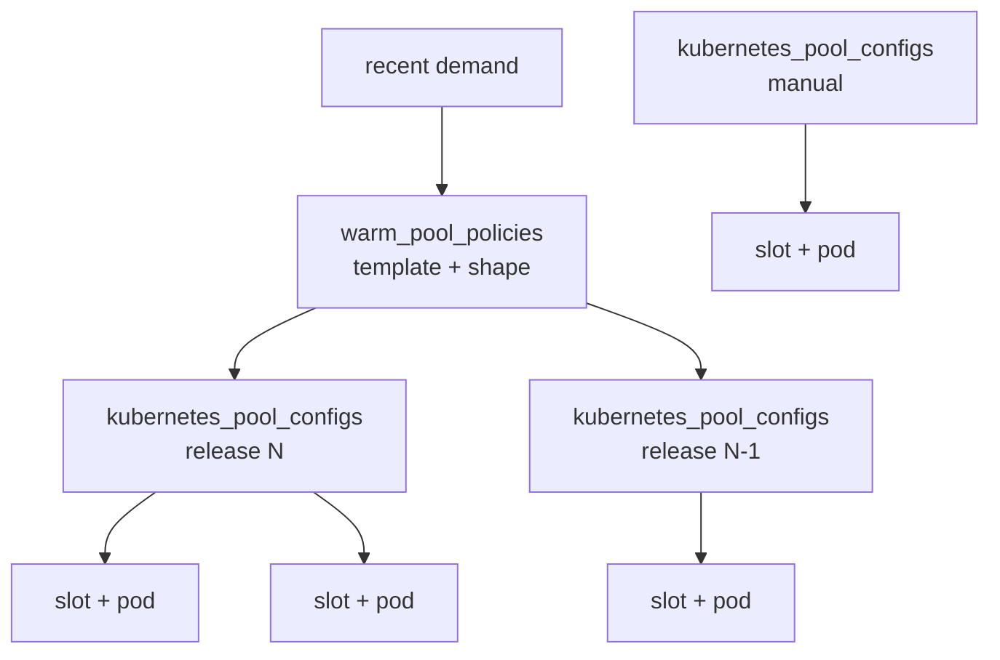
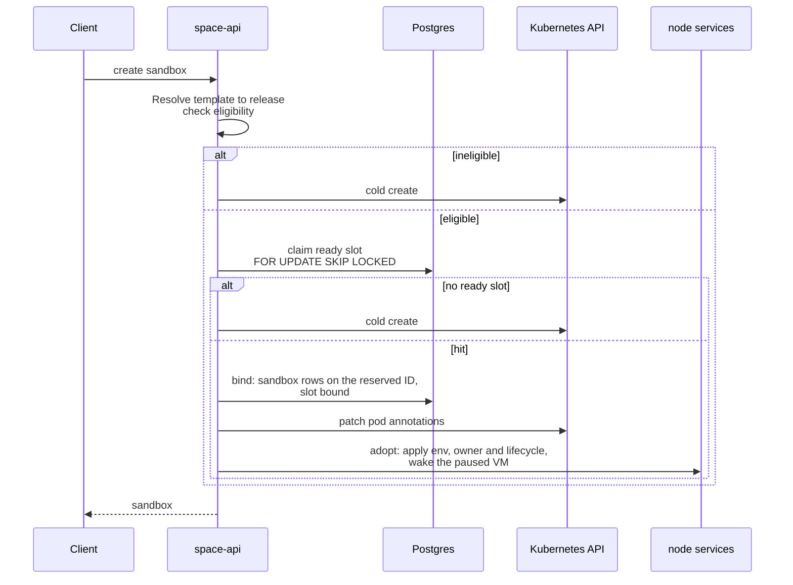

# Warm pools

Status: implemented contract

How SPACE keeps booted sandboxes ready on Kubernetes, how a create claims one,
and how rolling policies keep pools on the newest template releases. For setup
steps, see the [Warm pools](../../warm-pools.md) guide.

## Why warm pools exist

A cold Kubernetes create pays for pod creation, scheduling, CNI and IP
propagation, shim startup, node-local VM boot and proxy readiness on the
request path. That adds up to seconds. A warm pool does that work before
demand: it keeps pods whose paused VM already runs the template. A create
becomes a database claim plus a wake.

The pool is an optimization only. The cold, on-demand create path stays the
correctness path. Any miss, mismatch or unsafe condition falls back to it.

## Objects

| Object | Kubernetes analogue | Owns |
| --- | --- | --- |
| `warm_pool_policies` row | `Deployment` plus HPA | Which template and VM shape get prepared capacity, the ready-slot bounds and how many releases to retain. |
| `kubernetes_pool_configs` row | `ReplicaSet` | Desired warm slots for one immutable template release and one VM shape. |
| `kubernetes_pool_slots` row and its pod | `Pod` | One claimable, pre-booted sandbox. |
| Demand calculation | `HorizontalPodAutoscaler` | A policy-owned config's target, inside the policy bounds. |

The analogy is limited. A `Deployment` decides which revision receives Service
traffic, but SPACE callers can address any release explicitly, so more than
one release of a template can stay warm at once.



### Pool configs

A config is keyed by an existing `template_releases.id`, not by a free-form
template string or tag. The API accepts names, tags and content hashes at the
public boundary, and resolves them to a release before it checks pool
eligibility. The unique key is `(template_release_id, vcpu, memory_mib,
encryptable)`.

| Column | Meaning |
| --- | --- |
| `template_release_id`, `vcpu`, `memory_mib` | The release and VM shape the slots run. |
| `encryptable` | Whether slots can serve creates that require volume encryption. An encryptable config and its plaintext twin are separate rows; neither serves the other's creates. |
| `disk_mib`, disk I/O limits | Disk sizing applied to the slots. |
| `target_ready_slots` | Ready slots to keep. |
| `refill_per_tick`, `max_warming_slots` | Refill pacing: new slots per reconcile tick and concurrent warming slots. |
| `namespace` | Kubernetes namespace for the pods, filled in from the API's substrate configuration. |
| `enabled` | Disabled configs stop filling, and their open slots drain. |
| `managed_by` | `manual` for operator-created configs, `autoscaler` for configs generated by a policy. |

Manual configs are created through the UI, `space-admin-cli warm-pool` or
`PUT /admin/api/v1/warm-pools`. Re-submitting the same release and shape
updates the existing row.

### Slots

A slot is a pre-created Kubernetes pod backed by a node-local paused VM. The
controller generates a future `reserved_sandbox_id` before it creates the pod,
and the pod carries the resolved release as annotations:

```yaml
space.pplx.net/pool-config-id: <pool-config-id>
space.pplx.net/pool-slot-id: <slot-id>
space.pplx.net/template: <template-name>
space.pplx.net/content-hash: <template-release-hash>
space.pplx.net/sandbox-id: <reserved-sandbox-id>
```

The pod is labelled `space.pplx.net/pool-role=warm`. The shim reads
`space.pplx.net/sandbox-id` from the OCI annotations and forwards it to
sandbox-manager as `CreateRequest.sandbox_id`. The control plane therefore
chooses the sandbox ID up front, and never has to ask node-local services for
it later.

Slot states:

```text
warming ─mark_ready→ ready ─claim→ claimed ─bind→ bound ─cleanup_pending→ cleanup_pending
                       ▲                 │                     ▲
                       └────release──────┼─────cleanup_pending─┘
```

| State | Meaning | Written by |
| --- | --- | --- |
| `warming` | Pod created; VM not yet confirmed ready. | Controller |
| `ready` | Pod running, reserved sandbox reachable and paused. Claimable inventory. | Controller |
| `claimed` | A create has taken the slot out of inventory but has not committed sandbox ownership. | API |
| `bound` | The bind transaction committed: sandbox rows own the pod, and the slot row is only a retirement receipt. | API |
| `cleanup_pending` | The sandbox failed to boot after the claim. A durable work item for the controller. | API |

`release` returns a claimed slot to `ready` when the claim is abandoned before
any sandbox row references the pod, for example when the claimed pod fails
validation. Row deletion is legal from any state and is guarded by
state-scoped `DELETE` statements.

State ownership stays simple. The controller owns `warming → ready` and all
cleanup. The API owns `ready → claimed → bound`, `release` and
`cleanup_pending`. Node-local services never write pool rows.

## Create path



### Eligibility

A create can use a slot only when all of the following hold. Otherwise it is
ineligible and cold-boots.

- The backend is Firecracker and the boot mode allows a pool.
- The create does not request a custom `disk_mib` or file-change tracking.
- The create waits until the sandbox is ready, or its effective auto-lifecycle
  policy wakes on access or on command. A slot's VM is paused; the public
  create can report `started` because the next access or command wakes it.
- Request environment variables are allowed only when the substrate can apply
  them to an adopted sandbox.
- The create's sandbox ID is not already published. An adopted slot keeps its
  reserved ID, so a create with a pinned ID cannot adopt one, except through
  admission-time claiming, below.

### Claim and bind

The claim selects the oldest `ready` slot of an enabled config for the
resolved release, with `FOR UPDATE SKIP LOCKED`, so concurrent creates never
take the same slot. When the create names both `vcpu` and `memory_mib`, only
that exact shape matches. When it names neither, any enabled shape for the
release can match. The create's encryption requirement must equal the
config's `encryptable` value.

Bind is a separate transaction. It inserts the sandbox rows and the
generation-1 `sandbox_k8s_executions` row on the slot's reserved sandbox ID,
and marks the slot `bound` in the same transaction. A `claimed` row older than
the claim timeout is therefore a handoff that died before bind.

After bind, the API patches the pod's annotations and calls node-local
adoption. Adoption applies the owner, environment and final auto-lifecycle
policy, then wakes the VM. Node-local services do not query Kubernetes.

A failure before bind releases or invalidates the claim, and the create falls
back to cold. A boot failure after the claim parks the slot in
`cleanup_pending`; it never returns to inventory.

### E2B-compatible and native creates

E2B-compatible creates through ECW let the executor choose the sandbox ID,
send no shape and always wait for readiness. They claim during execution.

Native `POST /v1/sandboxes` creates publish their sandbox ID when the request
is admitted, before execution. With admission-time claiming enabled
(`SPACE_NATIVE_CREATE_POOL_CLAIM_ENABLED` and the
`space-native-create-pool-claim` flag), an eligible create claims a ready slot
in the same transaction that records it. It takes the slot's reserved ID as
its public ID, and the claim travels in the operation for the executor to
bind. Otherwise native creates cold-boot. Admission outcomes are `hit`,
`miss`, `ineligible` and `disabled`.

### Cold fallback shape

A cold create that names no shape takes its shape from the preferred enabled
plaintext pool config for its release. If the release has no config, it takes
the shape from the template's preferred policy. Cold creates of a
policy-covered template are therefore recorded at the policy shape, which
lets their demand count toward that release when the autoscaler decides
whether to prepare it.

## Controller

The warm-pool reconciler runs in `space-cluster-controller`, every 5 seconds
by default. Several replicas can run, but they contend for a Kubernetes
`Lease`, and only the leader runs the reconciler set. Standbys are warm, so
failover does not pay a cold start, and a leader that cannot renew its lease
stops its reconcilers before another replica takes over.

Each config passes through these stages on every tick:

1. Delete open slots whose pod no longer matches the config.
2. Observe ready slots, then observe warming slots. A warming slot is promoted
   to `ready` only after the controller connects to its reserved sandbox and
   it reports ready. Warming slots that exceed their timeout, 10 minutes by
   default, are deleted.
3. Evict unclaimed slots on cordoned nodes, so the freed deficit refills on
   schedulable nodes in the same tick.
4. Delete open slots above the target.
5. Refill:
   `min(target_ready_slots - open, refill_per_tick, max_warming_slots - warming)`.
   Creates within one tick run concurrently, and one failed create neither
   aborts the tick nor blocks the others. When the authoritative slot count is
   unavailable, refill stays closed.

Cluster-wide stages collect:

- stale `claimed` slots past the claim timeout, 5 minutes by default
- `cleanup_pending` slots
- `bound` receipts whose execution has retired
- disabled configs, whose open slots drain
- orphaned terminal pool pods: pods labelled `pool-role=warm` in a terminal
  phase with no slot row and no active execution

The orphan sweep is dry-run by default; enable deletion with
`SPACE_WARM_POOL_ORPHAN_GC_ENABLED`. The active-execution check is the
load-bearing guard: an adopted user sandbox keeps the `pool-role=warm` label.

Before it fills a config, the controller requests that the exact template
release be present on eligible worker nodes. Artifact cleanup treats releases
retained by pools as protected, and shares the policy's release selection so
the two cannot drift apart.

If the cluster cannot schedule pool pods, refill is bounded by
`refill_per_tick` and `max_warming_slots`, and user creates continue through
cold fallback.

## Rolling warm-pool policies

A manual config pins one release, so it stops serving once callers move to a
newer release. Traffic-driven autoscaling alone cannot fix that, because it
only discovers a release after cold requests have already happened. External
callers can also request a newly published tag without running any
preparation step.

A policy is an opt-in record for one template, runtime and VM shape:

| Column | Meaning |
| --- | --- |
| `template_name`, `runtime` | Template and runtime to prepare. |
| `vcpu`, `memory_mib` | The claimable VM shape the policy covers. |
| `min_ready_slots`, `max_ready_slots` | Per-release ready floor and demand ceiling. |
| `refill_per_tick`, `max_warming_slots` | Pacing for each generated config. Defaults are 5 and 10. |
| `retain_releases` | Newest releases to prepare without demand. Also caps how many extra releases demand can add. |
| `enabled` | Whether the policy produces configs. |

`min_ready_slots` applies to each retained release. `retain_releases=3` with
`min_ready_slots=5` keeps 15 ready slots with zero demand.

### Reconciliation

For each enabled policy, on each tick:

1. Rank matching releases by publication recency: the newest tag
   `modified_at`, or the release's `created_at` when it has no tags. Moving any
   tag to a known release, including republishing an existing build, puts it
   back at the front.
2. Select the newest `retain_releases` releases, even with zero demand.
3. Also select up to `retain_releases` older releases with at least 10
   sandboxes for that exact release and policy shape in the last 24 hours,
   busiest first.
4. Upsert an `autoscaler` config for each selected release, with
   `target = min(max_ready_slots, max(min_ready_slots, ceil(demand / 10)))`.
5. Disable `autoscaler` configs that are no longer selected. Their open slots
   drain, and the empty config is deleted later. Claimed slots keep their
   parent config until sandbox cleanup removes the slot row.

Changing a policy's shape selects new keys. Configs at the old shape drain
while configs at the new shape fill. Reconciliation is convergent rather than
transactional: if the controller stops partway through, the next tick
recomputes the selection and continues.

The demand threshold and the per-policy cap stop a one-off or
caller-controlled series of content hashes from creating unbounded floors.
The lookback, the threshold and the ratio of one ready slot per 10 sandboxes
are fixed in the controller.

The controller never adopts, changes or retires `manual` configs. To keep one
policy-owned release warm beyond retention, detach its config, which sets
`managed_by='manual'` with an explicit target. The UI's **Detach and Save**
action does this. Returning a detached config to `autoscaler` must be
deliberate, because the next tick can drain it straight away.

### Release workflow

1. Build and publish a new release, for example `my-template:<new-sha>`.
2. The policy notices the publication on the next ticks and fills the new
   release's floor.
3. Leave preparation time before callers move to the new release. Readiness
   is asynchronous, and there is no readiness API to gate on yet.
4. Demand then scales the new release, and older releases keep floors only
   while they are retained or busy.

Arbitrary templates, custom shapes and requests made between publication and
readiness have no warm-latency guarantee.

### Capacity

There is no global slot quota. Slot counts at different shapes are not
comparable, and a quota that counted draining releases could block a new
release from preparing. Operators approve each policy's floor and ceiling, and
Kubernetes scheduling supplies the physical backpressure.

Before enabling policies, compute the zero-demand floor in vCPU and memory per
shape:

```sql
SELECT
    template_name,
    runtime,
    retain_releases * min_ready_slots AS zero_demand_ready_floor,
    retain_releases * min_ready_slots * vcpu AS zero_demand_vcpu,
    retain_releases * min_ready_slots * memory_mib AS zero_demand_memory_mib
FROM warm_pool_policies
WHERE enabled;
```

Add headroom for demand-expanded targets, busy older releases and slots that
are draining during a rollover.

## Failure rules

| Condition | Result |
| --- | --- |
| No ready slot, or no matching config | Cold create. |
| Request ineligible (shape, disk, file changes, lifecycle, env, pinned ID) | Cold create. |
| Two creates race for one slot | `SKIP LOCKED` gives each a different slot or a miss. |
| Claimed pod fails validation before bind | Claim released or invalidated; cold create. |
| Claim handoff dies before bind | Stale-claim sweep deletes the slot and pod after the claim timeout. |
| Boot fails after claim | Slot parked in `cleanup_pending`, then collected; never returned to inventory. |
| Unclaimed pod missing, mismatched or on a cordoned node | Slot deleted, refilled later. |
| Warming slot never becomes ready | Deleted after the warming timeout. |
| Pool pods cannot be scheduled | Refill stays bounded; creates fall back to cold. |

## Limits

- Demand counts sandbox rows that still exist. Failed pool-only requests and
  deleted sandboxes leave no durable demand. Publication recency, not demand,
  is what prepares a republished release whose first requests all miss.
- Sparse traffic for an old release can fall outside the 24-hour lookback.
  Raising `retain_releases` protects more of the newest releases, not one
  specific old release; detach a config to keep one specific release warm.
- If an exact build is missing when a pool refills, materializing it adds to
  refill latency.
- Lookback, demand threshold and ratio are global, not per policy.

## Observability

| Metric | Shows |
| --- | --- |
| `warm_pool.slots` | Slot count by `content_hash`, `managed_by` and `state` (`warming`, `ready`, `claimed`, `bound`, `cleanup_pending`, plus `desired`). Compare `ready` with `desired` to find unmet floors. |
| `warm_pool.create_path.duration_ms` | Create latency by `outcome`: `warm_hit`, `ordinary_miss`, `same_claim_retry`, `later_warm_recovery`, `cold_fallback`, `cold_direct`, `error`. |
| `warm_pool.admission_claim` | Native admission outcome: `hit`, `miss`, `ineligible`, `disabled`. |
| `warm_pool.acquire.duration_ms` | Claim latency by hit, miss or error. |
| `warm_pool.promote.*` | Warming-to-ready probe attempts, steps and latency. |
| `warm_pool.reconcile.*` | Per-tick created, ready, deleted and evicted slots, stage and tick duration, and per-config state. |

## Out of scope

- A publish-time readiness API, or tags that become requestable only once
  their floor is ready.
- Per-policy lookback, demand ratio or burst modelling.
- A global cross-policy slot or resource quota.
- Coordinating retained releases across clusters, template renames or release
  deletion.
- A first-class operation to return a detached config to policy control.
