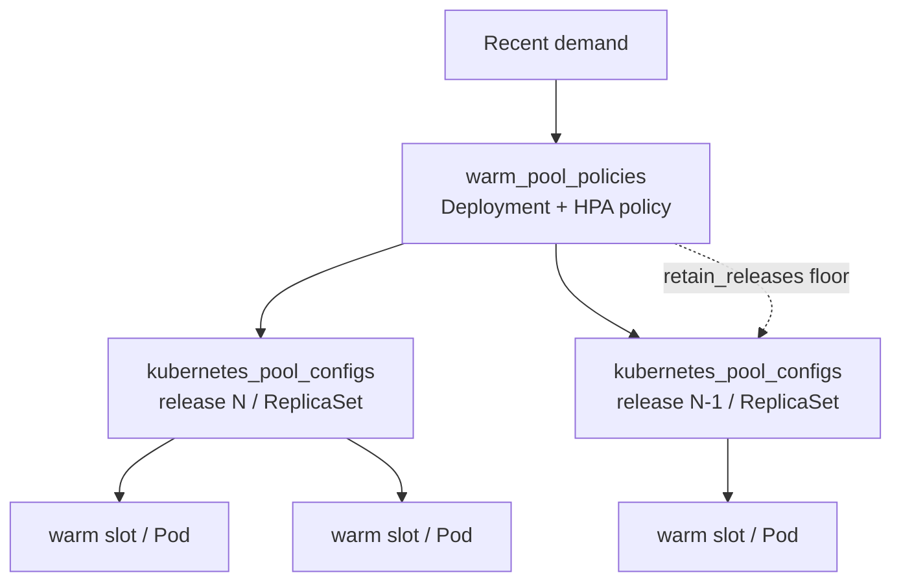
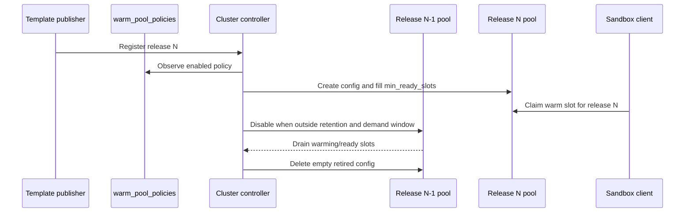

# Warm-Pool Release Preparation Policies

**Status:** proposed (v1)

## Problem

An ECW template build publishes an immutable release such as
`my-template:<git-sha>`. Consumers then begin creating sandboxes with that exact
release. A release without an existing warm pool turns the first creates from
the sub-100 ms claim path into multi-second cold boots.

Traffic-derived autoscaling cannot prevent that transition. It discovers a
release only after cold requests have already occurred, and pool-only requests
can fail without leaving usage from which to discover the release.

SPACE also cannot rely only on a coordinated application rollout. External
clients may request a published template tag without calling a preparation
workflow first.

## Decision

SPACE stores an opt-in warm-pool policy for each template runtime and supported
VM shape. Once a matching immutable template release is registered, the
cluster-controller reconciler creates a warm-pool config for that release even
when it has no observed sandbox demand. Sustained demand for a valid exact
release and policy shape can create an additional pool outside that proactive
window, and demand adjusts every selected pool's desired count within the
policy bounds.

V1 is asynchronous: a newly registered release is prepared on the next warm
pool reconcile ticks. This prevents latency spikes when publication precedes
consumer deployment, as in a build-and-version-bump workflow. It does
not guarantee a warm claim for an external caller that requests a new tag
immediately after it is made visible.

Strict publish-time availability is a follow-up: keep a new public tag in a
`preparing` state until its policy floor is ready, then atomically activate the
tag for create requests.

## Kubernetes Analogy

| SPACE object | Kubernetes analogue | Responsibility |
| --- | --- | --- |
| `warm_pool_policies` row | `Deployment` plus HPA configuration | Declares which template/shape receives prepared capacity, bounds, and retained revisions. |
| `kubernetes_pool_configs` row | `ReplicaSet` | Owns desired warm slots for one immutable template release and VM shape. |
| `kubernetes_pool_slots` row / pod | `Pod` | A claimable prewarmed execution. |
| Demand calculation | `HorizontalPodAutoscaler` | Adjusts the target inside policy min/max bounds. |

The analogy is intentionally limited. A Kubernetes Deployment controls which
revision receives Service traffic. SPACE callers can explicitly address old
template releases, so more than one retained release may remain warm.



## Data Model

`warm_pool_policies` owns stable desired state:

| Column | Meaning |
| --- | --- |
| `template_name`, `runtime` | Template family and runtime to prepare. |
| `vcpu`, `memory_mib` | One claimable VM shape covered by the policy. |
| `min_ready_slots`, `max_ready_slots` | Ready-slot floor and demand-scaling ceiling. |
| `refill_per_tick` | Maximum new warming slots created per reconcile tick for each selected release. |
| `max_warming_slots` | Maximum concurrent warming slots for each selected release. |
| `retain_releases` | Number of newest immutable releases prepared without demand. |
| `enabled` | Whether the policy currently produces desired configs. |

`min_ready_slots` applies to each retained immutable release, not to the
policy as a whole. For example, `retain_releases=3` with
`min_ready_slots=5` declares a zero-demand steady-state floor of 15 ready
slots for that policy.

The retained window is ordered by publication recency. Registration writes
immutable release rows idempotently by content hash, so republishing an
existing build does not change the release row's original `created_at`.
Creating or moving any release tag records publication intent in the current
model and updates `template_release_tags.modified_at`; reconciliation uses the
newest tag timestamp, falling back to the release's creation time when it has
no tags. This lets a previously known exact release re-enter the retained
window when its digest, `latest`, `prod`, or another publication alias moves to
it.

Demand admission, sizing cadence (`sandboxes_per_ready_slot`), and lookback
remain fixed in the controller implementation in v1. Refill rate and warming
parallelism are policy fields so operators can tune rollout pacing per template
and shape. An unretained release becomes eligible after one full sizing bucket
(10 surviving sandbox rows) for its exact release and policy shape in the 24-hour
lookback. For each policy, at most `retain_releases` additional unretained
releases are selected, preferring the busiest. This threshold and cap prevent a
one-off or caller-controlled series of hashes from creating unbounded policy
floors. Using one cluster-wide ratio keeps v1 operationally simple; it does not
model per-template sandbox lifetimes or bursts.

V1 does not add a global slot-count cap. Slot counts across different VM
shapes are not comparable, and a quota that includes draining old revisions
can prevent the newly published release from preparing. Operators explicitly
approve each policy's per-release floor and ceiling; Kubernetes scheduling
provides physical placement backpressure.

`kubernetes_pool_configs` remains keyed by immutable
`(template_release_id, vcpu, memory_mib)`. Policy-owned rows continue using
`managed_by='autoscaler'`; this describes the controller that maintains their
target while the new table describes why the release is eligible.

## Reconciliation

For each enabled policy:

1. Rank matching registered template releases by newest publication-first,
   falling back to original release creation for untagged releases.
2. Select the newest `retain_releases`, even with zero recent demand.
3. Also select up to `retain_releases` older releases with at least 10 matching
   persisted sandbox rows inside the 24-hour lookback, ordered by highest demand.
   Demand is deduplicated by exact release and policy shape, and only a
   registered release covered by an enabled runtime/shape policy is eligible.
4. For each selected release, upsert a policy-owned pool config with:

   `target = min(max_ready_slots, max(min_ready_slots, ceil(demand / ratio)))`.

5. Disable policy-owned configs no longer selected. Their open slots drain
   through the existing reconciler until deleted.
6. Reconcile selected configs into warming and ready slots using the existing
   exact-release pod path.
7. Delete disabled autoscaler-owned configs once they have no remaining slots.
   Claimed slots keep their parent config until their sandbox cleanup removes
   the slot row.

Changing a policy's `vcpu` or `memory_mib` selects a new release/shape key:
the prior-shape autoscaler configs become stale and drain while new-shape
configs prepare in parallel.

Reconciliation is convergent rather than transactional. If the singleton
controller exits after updating only part of the desired set, the next tick
recomputes candidates, resumes preparation, and disables or deletes stale
autoscaler-owned configs.

Selected configs reconcile in stable template and revision order. A new
release is not blocked by an arbitrary slot-count quota while an old revision
drains; its placement can still wait for actual cluster resource availability.



## Release Workflow

For a build-and-version-bump workflow:

1. Build and publish `my-template:<new-sha>` into SPACE.
2. The enabled `my-template` policy notices the publication and begins preparing
   its pool. Republishing an existing immutable build has the same effect.
3. The workflow leaves preparation time before merging its application
   version-bump PR. V1 has no supported readiness API for an automated hard
   gate; adding one is a follow-up rather than coupling a pipeline to database
   tables.
4. Demand scaling grows the selected release once traffic arrives.
5. Older releases retain their floors only according to `retain_releases` or
   while sustained demand keeps them in the bounded demand-selected set.

Uncontrolled clients receive the same benefit for policy-covered
template/shape pairs after preparation converges. Arbitrary templates, custom
shapes, and requests made during the publish-to-ready window have no v1 warm
latency guarantee.

## Lifecycle And Leak Audit

| Resource | Retirement behaviour | V1 status |
| --- | --- | --- |
| Ready or warming slot pods for an old release | Pool config is disabled once unretained and idle; existing reconciler deletes its unclaimed open slots. | Bounded; covered by stale-disable and retirement tests |
| Autoscaler-owned `kubernetes_pool_configs` rows | Deleted after retirement once no slot rows remain. Claimed slots retain the parent until sandbox cleanup finishes. | Bounded; covered by empty-retired-config deletion tests |
| Claimed slots | Owned by the running sandbox after claim and removed by existing sandbox cleanup; stale unbound claims have an existing timeout sweep. | Existing lifecycle |
| Node-local exact template artifacts pulled for prepared releases | Existing warm-pool reconciliation requests exact-release materialization on eligible nodes. Template artifact cache retention remains separate from warm-pool policy reconciliation; a later refill rematerializes an exact release if its artifact is absent. | Outside v1 policy lifecycle |

Rolling warm pools are implemented for claimable capacity and their
controller-owned config rows. Each resulting `kubernetes_pool_configs` row
uses the existing warm-pool exact-release path: the controller requests its
template digest on eligible worker nodes before filling slots. This path does
not depend on `PREFETCH_TAG_TUPLES` or
`SPACE_TEMPLATE_PREFETCH_LATEST_N`; background prefetch can still warm
additional recent releases independently. Kubernetes-native warm slots are
created as `root@local` sandboxes, while template-manager's `sbx-mgr.List()`
view contains only `tmplmgr@local` sandboxes. They therefore do not establish
an artifact-retention contract for warm slots. Template artifact cache
retention and disk-budget configuration are outside this RFC; when an exact
artifact is absent during a later refill, the existing materialization path
pulls it again.

## Operations

Before enabling policies, calculate the zero-demand retained floor:

`baseline_slots = sum(retain_releases * min_ready_slots)` over enabled policies.

Evaluate that baseline in vCPU and memory for each VM shape, then add
headroom for demand-expanded targets, older releases still selected by recent
demand, and disabled slots draining during rollover. Compare
`warm_pool.slots{state:ready}` with `warm_pool.slots{state:desired}` for
unfulfilled floors, grouping by immutable `content_hash` to verify the new
release fills before an older release drains away.

For initial activation on a busy cluster, leave existing manual pool configs
in place, enable one policy in a non-production environment, and inspect the
zero-demand floor before expanding coverage. Manual configs are never adopted
or disabled by the autoscaler. An operator can calculate the declared floor
with:

```sql
SELECT
    template_name,
    runtime,
    retain_releases * min_ready_slots AS zero_demand_ready_floor,
    retain_releases * min_ready_slots * vcpu AS zero_demand_vcpu,
    retain_releases * min_ready_slots * memory_mib AS zero_demand_memory_mib
FROM warm_pool_policies
WHERE enabled;
```

During staged activation, operators can inspect converged autoscaler-owned
inventory with:

```sql
SELECT
    r.template_name,
    c.target_ready_slots,
    COUNT(*) FILTER (WHERE s.state = 'ready') AS ready_slots,
    COUNT(*) FILTER (WHERE s.state = 'warming') AS warming_slots
FROM kubernetes_pool_configs c
JOIN template_releases r ON r.id = c.template_release_id
LEFT JOIN kubernetes_pool_slots s ON s.config_id = c.id
WHERE c.managed_by = 'autoscaler'
GROUP BY r.template_name, c.id, c.target_ready_slots;
```

## Risks And Escape Hatch

An older release remains selected when matching sandboxes were created inside
the controller lookback window, even after it is outside `retain_releases`, once
it crosses the admission threshold and remains among the policy's busiest
bounded candidates. That is sufficient for steady persisted traffic, but it
has several limits:

- Failed pool-only requests emit observability events but do not create durable
  controller-readable demand. Persisting those misses directly would add I/O to
  the claim hot path, so v1 deliberately approximates demand from matching rows
  that still exist in `sandboxes`, regardless of lifecycle. Deleted sandboxes
  are absent from this view, while failed, deleting, or suspended rows still
  count until deletion or lookback expiry. Publication-recency selection still
  prepares a republished release proactively; this is the path that covers a
  newly republished release whose first requests all miss, such as the
  `d805b590...` incident.
- Sparse old-release traffic can fall outside the global lookback window.
  Increasing `retain_releases` protects the newest additional releases, not one
  arbitrary old release, while increasing the lookback can retain every
  recently used old release for longer.
- Warm slots do not define artifact-cache retention. If an exact build is not
  present when a pool later needs to refill, materialization adds refill
  latency.

If an operator discovers that one specific old release must remain warm, they
can detach its existing config from policy ownership, analogous to preserving
a `ReplicaSet` independently of its `Deployment`:

```sql
UPDATE kubernetes_pool_configs
SET managed_by = 'manual',
    target_ready_slots = 5,
    enabled = TRUE,
    updated_at = NOW()
WHERE id = '<pool-config-id>'
  AND managed_by = 'autoscaler';
```

The autoscaler skips `managed_by='manual'` configs and does not retire them.
Returning a detached config to `managed_by='autoscaler'` must be deliberate:
on the next reconciliation tick it can be disabled and drained immediately if
the release is outside retention and the demand lookback.
The Templates dashboard exposes this detach action on an autoscaler-owned
release pool and identifies manual versus autoscaler-owned pools.

## Non-Goals

- Providing a publish-time tag activation or readiness API in v1.
- Per-policy demand ratios, lookback windows, or burst modelling in v1.
- A global cross-policy slot-count or resource quota in v1.
- Coordinating retained releases across clusters, template renames, or
  release deletion workflows.

## Follow-Ups

- Add tag activation state so policy-covered public tags become requestable
  only after the ready floor is satisfied.
- Add readiness status and activation controls to the policy management UI.
- Add a first-class release pin or explicit adopt operation for returning a
  detached manual pool to policy control.
- Move lookback settings onto individual policies if operational needs diverge.
