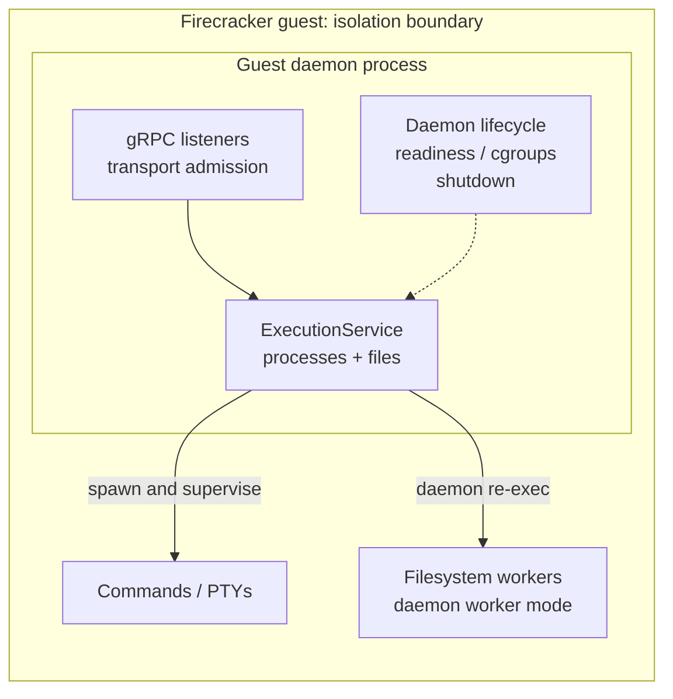
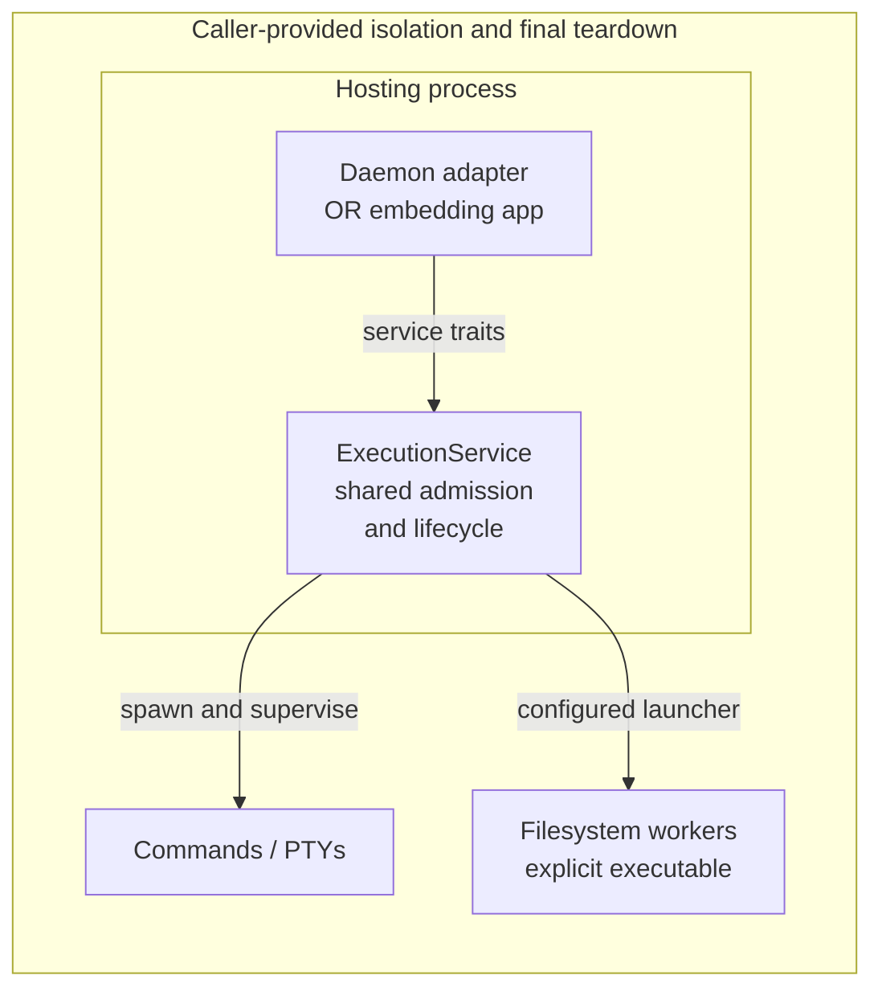

# Guest execution embedding contract

**Status: proposal.** Reuse SPACE's process/filesystem implementation inside an
independently isolated application, without guest listeners or daemon startup.
The [execution crate README](../../../crates/libs/spaced/guest/execution/README.md)
describes today's supported behavior; this RFC defines the work required for embedding.

## Decisions requested

1. **One contract:** daemon and embedding callers use `ExecutionService`, retaining
   generated service traits, protobuf values and Tonic operation errors.
2. **Initial profile:** privileged Linux hosting, provisioned non-root workloads,
   and an explicitly supplied, trusted worker-only executable.
3. **Ownership:** SPACE owns operations and their supervisors; the caller owns
   isolation, authorization, account provisioning and final descendant teardown.

Unprivileged hosting, privileged workloads, non-Linux embedding, and a new SPACE
sandbox backend require separate designs. Existing daemon support is unchanged.

## Before: the extracted daemon

The library is separated, but its production integration still supplies
whole-daemon assumptions. Filesystem workers re-execute the daemon through its
early dispatch hook; native calls do not acquire all transport admission checks
or a complete shutdown-and-reject contract.

## After: the proposed shared contract

Each deployment hosts its own service instance. Both integrations use the same
operation boundary; the embedding application has no guest-server dependency.
The daemon retains listeners, readiness and cgroup initialization. Embedding
supplies a worker-only binary and workload placement; the library never
rearranges the host's cgroup hierarchy.

Selecting an account or normalizing a path does not create isolation or confine
access to a workspace root. A separate convenience facade or duplicate error
hierarchy is unnecessary; application-specific wrappers remain downstream.

## Required contract

### Operations and admission

Cover the full [guest bridge operation inventory](../../../proto/spaced/bridge/guest/v1/guest.proto):
process start/reconnect/list/signal/stdin/PTY, filesystem stat/list/read/write/
**batch writes**, mkdir/remove/rename, watches and **file-change tracking**,
**process-environment configuration**, and **workload placement**. Environment
updates affect future starts only. Deprecated RPCs remain adapters; metadata and
networking remain daemon concerns, despite sharing the guest protocol crate.

Use existing [process](../../../crates/libs/spaced/guest/protocol/src/process_limits.rs)
and [filesystem](../../../crates/libs/spaced/guest/protocol/src/filesystem_limits.rs)
budgets at the shared operation boundary. Transport adapters keep predecode
protection and pass admission through without double charging. Native calls must
reject oversized values and bound streams, operations, workers, watches and retry
records; they cannot prevent the caller's prior allocations. Keep permits until
owned work settles, even if the response is dropped.

### Worker launch and identity

Construction requires a caller-provisioned, protected worker artifact, built and
tested with the library. Define executable resolution/replacement and ensure
validation and execution refer to the intended artifact. Never discover support
by running an arbitrary application's `current_exe()`; the daemon may explicitly
configure its known worker entrypoint. A handshake does not establish artifact trust.

Validate configuration at construction and protocol version/installed identity
before dispatch. Missing launchers, accounts, privileges, incompatible workers
and startup timeouts fail explicitly. Use typed construction/lifecycle errors.
Retain startup, cancellation, termination and reaping ownership after a dropped
future or timeout; replacement must not accumulate untracked workers. Inherit
only the worker channel and documented environment/telemetry inputs.

Install the selected UID, GID and supplementary groups in children, with no
inherited supervisor capabilities or privilege gain through set-ID/file-capability
executables. Check capability state as well as IDs. Never change existing host
threads' credentials, capabilities, signal handlers or cgroup membership.
**Direct filesystem mode is unsupported in this profile:** it uses host authority
and must neither masquerade as impersonation nor serve as a worker-start fallback.
Keep daemon policy differences explicit within the same identity implementation.

### Shutdown and ownership

Order operation registration with admission closure: **running → closing → drained**.
Closing rejects every new operation, including reads, mutations, watches and
environment updates. Repeated shutdown observes the same transition. Successful
drain means owned operations, worker startup/cleanup and command supervisors have
settled, filesystem workers are reaped, and no later library-dispatched effects
can begin.

A deadline bounds waiting, not OS completion. Timeout reports **incomplete cleanup**,
retains ownership and closed admission, and permits later observation/drain.
Cancellation preserves retry records, stream outcomes and uncertainty; it does
not roll back dispatched effects or make a fresh-key retry safe. Drain implies
neither flush nor crash persistence; retain the [guest I/O contract](../design/guest-io.md).

Process ownership covers leaders, streams and groups while supervision is active,
not every descendant. Detached/redirected descendants can survive and keep writing
after successful drain; **the caller must tear down its isolation boundary**.
Placement alone is not containment. Never kill unrelated host processes. Preserve
Linux's atomic close-on-exec PTY allocation alongside unrelated application spawns.
Dropping a service handle is not proof of cleanup.

## Acceptance and rollout

Maintain an upstream application that uses the execution crate and real Linux
identity workers, without guest-server or Direct mode. Use synthetic accounts in
disposable isolation. Support each Linux architecture only after its kernel,
privilege and integration requirements are exercised; CI must fail on missing
requirements rather than silently skip them.

| Focus | Evidence required |
| --- | --- |
| Launch / identity | Invalid launcher, protocol mismatch, failed/cancelled startup, replacement and reaping; UID/GID/groups, access checks, inherited capabilities and executable privilege gain. |
| Operations / budgets | Complete inventory above, overload, oversized input, streaming backpressure and permits retained through cancellation; equivalent transport/native execution budgets. |
| Lifecycle / ownership | Admission-close races, every post-close entrypoint, interrupted uploads, repeat/incomplete drain, retry uncertainty, unrelated spawns, descriptor inheritance and surviving descendants. |
| Integration | Embedding exercises the supported worker path and caller teardown; existing daemon tests and Kind/Firecracker checks cover shared behavior changes. |

Implement in reviewable steps: **launcher + representative integration → identity
policy → shared admission/shutdown → complete CI and consumption documentation**.
Each PR identifies established and pending guarantees; launcher work alone does
not establish embedding support. Preserve wire/import compatibility and follow
[versioning policy](../../versioning.md). Packaging and hermetic consumer builds
need separate validation.
