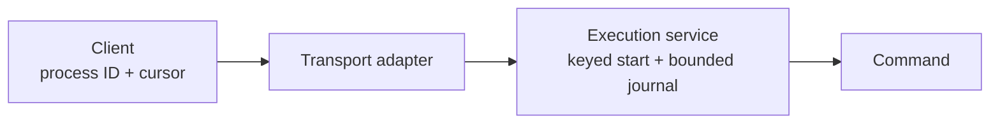
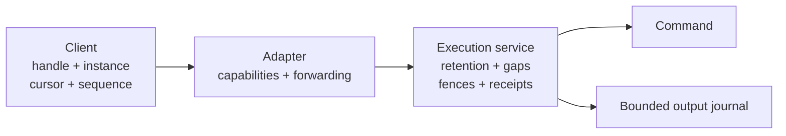

# Process replay and retry contracts

**Status: proposal.** Extend the existing process API for reconnecting terminals,
independent output readers and job runners. Keep commands, output and supervision
in one execution service; callers keep their handles and read positions.

This is independent of the [embedding contract](2026-10-06-guest-execution-embedding.md).
Embedding defines how an application hosts the service. This proposal defines
additional guarantees for its process clients, whether the service runs in a
guest daemon or an embedding application.

## Scope and implementation

| Primitive | Delivery |
| --- | --- |
| Configurable exit, output and completed-start retention | [Separate retention implementation](https://github.com/perplexityai/SPACE/pull/888). |
| Counted output gaps with opt-in replay | [Gap-recovery implementation](https://github.com/perplexityai/SPACE/pull/889). |
| Bind a start key to the request it identifies | Proposed opt-in recovery start; equality and compatibility are specified below. |
| Reject stale engine and process handles | Proposed recovery handle, using discovery before the first start. |
| Deduplicate process input, stdin closure and signals | Proposed ordered, bounded mutation receipts below. |
| Capability discovery and end-to-end forwarding | Initial readiness/status discovery is described below. Operation enforcement and complete external API exposure remain proposed. |

The first two changes do not provide the remaining guarantees. Field names for
later changes are provisional; do not reserve wire numbers until implementation.
The [operation schema](../../../proto/spaced/operations/v1/operations.proto) is
the source of truth for existing field numbers and types.

## Before and proposed contract

Today, clients can retry a keyed start within its bounded lifetime and reconnect
from an output cursor. Retention is fixed, output can expire before the exit
record, and a lagging reader can fail or use `resume_from_oldest_retained` without
receiving an exact lost-byte count. Input and signal retries can repeat effects;
a process handle does not identify an engine lifetime.





Clients decide polling duration, output presentation and shell invocation. The
engine adds no Poll RPC, client registration, destructive read cursor, output
summary or automatic command rerun. Existing Process RPCs remain the operation
boundary; any discovery addition must use an explicitly reviewed metadata path.

## Retention

`ExecutionServiceConfig::process_retention` configures three independent windows:

| Window | Default | Meaning |
| --- | --- | --- |
| `completed` | 15 minutes | Keep the completed process record and exit. |
| `output` | 60 seconds | Keep completed output and environment, no longer than the record. |
| `idempotency` | 60 seconds | Keep completed keyed-start results. |

Output retention must not exceed completed-record retention; construction rejects
that configuration rather than silently shortening the requested window. Each
window must be nonzero and at most seven days. In-progress starts retain
their fixed 60-second bound. The existing record limits, output budgets and
eviction rules still apply: a longer window is not a reservation of capacity.
Record eviction can end reconnectability before the configured deadline. A key
record does not independently preserve the process's output.

Defaults preserve daemon behavior. For late output readers, configure both
`completed` and `output`; extending exit retention alone does not retain bytes.
These are in-memory, monotonic-clock windows, not persistence across restart.
Rust configuration changes follow the experimental crate-API policy.

## Output gaps

`ConnectProcess.resume_after_output_gap` opts into a `ProcessOutputGap` event
followed by retained output and, when available, the exit. The event contains:

- `skipped_events`: output events missed by this reader;
- `output_cursor`: the next output position the reader should use;
- `output_bytes_before`: cumulative stdout/stderr bytes before that position.

The reader advances its cursor for output events and replaces it with the gap's
cursor on a gap. Readers that track cumulative bytes can derive lost bytes from
`output_bytes_before`. Control events do not advance an output cursor. Several
readers can hold independent cursors; reads consume no shared client position.

The new option uses request field 5 and connection-acknowledgement field 2,
preserving `resume_from_oldest_retained` at field 4 and the existing connected
cursor at field 1. If both recovery options are enabled, the counted-gap option
takes precedence for reporting the lost output. When producer backpressure is
available, a stale gap reader atomically claims the first retained position while
preserving its original cursor for the gap event. Reporting the gap does not
release that hold. A reader does not displace an existing primary reader;
observers can still encounter further gaps. Callers omitting the option retain
existing reconnect behavior.

The host requires an affirmative first `Connected` event for cursor-based opt-ins;
a missing, malformed or unacknowledged event is refused. Upstream errors are
propagated. Completed cursorless replay retains its existing started/exit shape;
it is not proof of capability support. Native and
compatibility endpoints do not opt in automatically. Full client exposure needs
explicit capability handling and forwarding at every intervening adapter.

Retrying a cursor is another read, not a promise that bytes remain forever:
eviction can turn a retry into a counted gap, and record expiry can make the
handle unavailable. A future cursor still fails rather than silently moving it.

## Proposed recovery requests

The following contracts remain proposals. Discovery can ship independently;
it does not enable these guarantees. Implement each operation with its adapter
forwarding, compatibility checks and owning tests before advertising support.

### Fail closed on older peers

A new optional fence or sequence field alone is insufficient: protobuf readers
ignore unknown fields. A readiness check also cannot prevent a peer replacement
between discovery and a mutation. The recovery form must therefore be invalid
as a legacy request, not merely accompanied by a capability assertion.

| Operation | Proposed recovery form | What a legacy reader sees |
| --- | --- | --- |
| Start | A recovery envelope containing the command, expected engine instance and contract version. The existing command field must be empty. | An empty command, rejected before launching. |
| ConnectProcess and process controls | A recovery envelope containing the process handle and contract version. The existing process ID field must be empty. | An empty process ID, rejected before lookup or effects. |

Both forms populated is `InvalidArgument`. New readers reject unknown contract
versions before replay, lookup or effects; adapters preserve the envelope rather
than copying its values into legacy fields. Adding an effect-related field to an
existing recovery envelope requires a new enforced contract version. An old
recovery reader must reject it, not ignore the new guarantee. Capability names
identify the supported operation contracts; they do not replace these checks.

Existing requests retain their current behavior. These are additive fields on
the existing RPCs, not new Process methods. Envelope names and field numbers
remain provisional until implementation. Compatibility tests must send encoded
recovery requests to an actual older service, not just test the new validator.

### Bind start keys to requests

After message-size validation and payload admission, recovery Start binds its
key atomically to the validated request before any account lookup, PTY allocation
or process launch. A matching retry waits for the
same owner or replays its result. A conflicting request returns `InvalidArgument`
without waiting for the original launch. Legacy and recovery use of one key
cannot be upgraded or downgraded: a mode mismatch returns `FailedPrecondition`.
Legacy keys used only by legacy requests keep their current behavior.

| Equality input | Rule |
| --- | --- |
| Command, user, cwd, tag, requested process ID | Compare supplied values and option presence. Omitted and explicitly supplied defaults are distinct; do not resolve filesystem aliases. |
| Environment | Validate the complete supplied map, then compare entries independent of order. Recovery starts reject invalid entries; legacy parsing remains unchanged. |
| Timeout, background, stdin, PTY, clean environment | Include every field and option presence. Validate values before binding. |
| Configured environment, account data and default cwd | Resolve once for the owning launch. A retry replays that launch, even if defaults or account data change. |
| Engine instance, activation and contract version | Validate the identities before key lookup and compare UUID values, not their spelling; versions with different request semantics cannot share a binding. |

Store a server-computed cryptographic digest of canonical request data alongside
the bounded key record; do not retain another copy of argv or environment.
Canonical encoding must be unambiguous and account for every execution-affecting
field. Do not accept a caller-supplied digest as evidence of equality.

A matching keyed replay precedes the caller-assigned process-ID collision check
in recovery mode. Another key using an occupied process ID still fails; it must
not silently attach to that process. The legacy collision precedence is unchanged.
Dropping an unstarted reservation releases its binding. After launch ownership
transfers, cancellation must not permit another launch or discard its result.

The existing key window and capacity limits still bound deduplication. Discovery
must expose the configured key window before clients enable recovery starts.
Clients bound their retry deadline from the first attempt; after the window,
the result is unknown and automatic resend is unsafe, even if the engine has
not restarted. Expired tombstones need not live forever. A key outliving its
output or process record retains the expiry behavior specified under retention.

### Discover the execution service before effects

Use the existing readiness/status metadata path rather than a new Process RPC.
`process_execution` carries an opaque `instance_id` and named guest capabilities
from the same readiness observation. The native service exposes the same data
through `process_execution_info()`. Older guests and adapters omit it; absence
never authorizes an opt-in. Each adapter intersects the guest list with the
guarantees its request path implements; unknown names are omitted. A newer guest
behind an older adapter must not advertise a guarantee that the adapter would strip on the request.
Version numbers alone never establish support. Native and raw guest discovery
identify implemented contracts; a missing activation means they cannot accept
recovery calls yet. Routed discovery additionally filters recovery capabilities
until activation is confirmed.

For the public command transport, manager discovery does not establish support
on an independently deployed data plane. Require the WebSocket subprotocol
`space.process-recovery.v1` to be acknowledged by the serving connection before
sending credentials or recovery requests. There is no fallback to legacy frames.

The identity belongs to the in-memory execution state. Cloning a service handle
or reconnecting does not change it; constructing a replacement does. A memory
snapshot preserves the state and identity, including when cloned to a different
sandbox. Handles therefore include the sandbox identity as well as the instance.
This addition advertises only implemented capabilities, initially output-gap
recovery. It does not yet implement fencing, bound starts or mutation receipts.
Those operations must separately enforce their expectations before effects;
discovery followed by an unchecked mutation would still have a restart race.

### Fence engine and process lifetimes

A recovery start requires the instance observed **before the first attempt**.
The service checks it before keyed replay, ID collision checks or launch. A
mismatch returns `FailedPrecondition` with a machine-readable instance-mismatch
reason; it never reruns the command. A lost first reply is retried with the same
key, request and original instance, not an instance learned from a later probe.

The first started event identifies both the engine instance and a fresh opaque
process incarnation. A recovery handle is the tuple:

```
(sandbox identity, engine instance, activation, process ID, process incarnation)
```

The incarnation distinguishes reuse of a caller-assigned process ID after record
expiry within the same engine. Connect and control operations check the engine,
then the selected record's incarnation, before replay or effects. A different
incarnation returns `FailedPrecondition` with a distinct reason; a missing record
remains `NotFound`. Tokens identify state; they are not authorization credentials.
Memory snapshots preserve these tokens and their records, so the sandbox identity
remains part of the caller's handle. It is not sufficient for rollback into the
same sandbox: restoring an earlier image also rewinds keys and mutation receipts.

Before recovery requests are admitted after a memory restore, the supervisor
must install a fresh activation epoch from outside the snapshot. Recovery
requests carry both the in-memory instance ID and that activation epoch;
repeated notification of the same activation is idempotent. The routing path
gates recovery traffic until this handshake completes. A native host supporting memory restore must supply the
same lifecycle boundary. Discovery's current in-memory ID alone does not provide
this guarantee. Conservatively invalidate recovery handles on every memory
restore, including suspend/restore; resident pause/resume keeps the instance.
Legacy operations retain their current lifecycle behavior. Fencing prevents new
requests using old handles; it cannot undo external effects of rolled-back work.

Quiescing is transient: recovery calls return `Unavailable` with
`temporarily_unavailable` while activation is absent or changing. Only a different
installed activation returns `activation_changed`; callers must not abandon live
handles merely because a scheduled flush quiesced the service. New recovery calls
fail promptly instead of queuing with payload capacity behind the barrier.
Disabling interrupts blocked recovery effects and waits for their terminal
receipts before flushing. Once quiescing begins, cancelling configuration leaves
recovery disabled until a subsequent change completes the barrier.

Recovery rearming is optional on ordinary readiness: first observe the guest,
then attempt rearming within a small part of the remaining request budget. A busy
snapshot lock or failed rearm removes recovery capabilities without failing
readiness. Preparation waits briefly for an admitted rearm instead of immediately
refusing because its lifecycle permit is busy.

Before implicitly resuming a resident paused sandbox, the manager validates its
external activation. Recovery requests never restore a suspended sandbox using
old fences. New public recovery command sessions require a running sandbox and
do not enqueue a wake; callers explicitly resume or restore, then discover the
execution for new work. Legacy command wake policy is unchanged.

### Snapshot activation handshake

The guest starts with recovery disabled. `WaitReady` supplies an opaque barrier;
`ActivateProcessRecovery` accepts an external activation only against that exact
barrier. Repeating the activation is idempotent. Changing it requires quiescence.
The existing `FlushFilesystems` RPC invalidates the barrier and disables recovery
before waiting for admitted effects. Disabling interrupts blocked recovery writes
and waits for their owners to publish terminal receipts before flushing. This also protects snapshot
preparation by older hosts. A delayed activation against an earlier barrier is
refused. Cancelling a flush does not release activation exclusion while its
blocking filesystem work still runs.

A host configured with an external activation starts quiesced. Its `WaitReady`
returns a separate host barrier; `ResumeProcessRecovery` accepts that barrier and
installs only the launch-configured activation. Preparation and ordinary guest
flushes invalidate the host barrier. A restarted host creates a new barrier while
retaining the resident VM's activation. Lost replies leave the host quiesced until
a confirmed retry. Neither readiness polling nor clock synchronization activates
recovery automatically.

The lifecycle owner must exclude snapshot preparation and capture while resuming
recovery, and must choose a fresh external activation after every actual memory
restore. Resident pause/resume, checkpoint completion and failed-capture rollback
can rearm the existing activation once the VM is running. Disk-only flushing also
quiesces recovery and requires rearming. Barriers are ordering tokens, not access
credentials; host metadata calls retain their existing peer authorization.

Node-manager derives the host's activation from the accepted execution fence,
including sidecar restarts; callers cannot override it through launch arguments.
The sandbox manager rearms lazily on readiness or a recovery call. It acquires
the existing snapshot artifact lock, reloads and authorizes a Started sandbox,
attests its current host, and holds the lock through activation confirmation.
A paused or transitioning VM cannot rearm. Host capabilities remain filtered
until the guest confirms the launch-bound activation. Hosts without activation
configuration and older guests retain the existing path.

### Deduplicate process mutations

SendInput, CloseStdin and SendSignal share one ordered sequence per recovery
handle. The caller coordinates writers; the engine adds no client registration.
Legacy controls remain available outside this ordering; callers must coordinate
any mixing of the two forms. Sequences start at one. The next operation uses the
preceding sequence plus one,
only after learning its terminal outcome. Sequence exhaustion is a terminal
refusal, never wraparound. ResizePty can use a fenced handle but is outside the
mutation-receipt contract in this proposal.

| Request | Result before any new effect |
| --- | --- |
| Next sequence, no owner in progress | Atomically reserve the operation kind and canonical payload digest. |
| Same sequence and payload as the in-flight owner | Wait for that owner; never perform the effect again. |
| Retained sequence and matching receipt | Replay the recorded success or error, even after the process exits. |
| Same in-flight or retained sequence with another operation or payload | `InvalidArgument`. |
| Sequence ahead of the next expected value, including while an earlier owner runs | `FailedPrecondition`; caller resolves the earlier operation first. |
| Sequence at or below the high-water mark whose receipt expired | `FailedPrecondition` with a receipt-expired reason; never acknowledge or reapply it. |

Retain the last 64 terminal receipts per process, until its record expires or is
evicted. Keep the high-water mark for the record's entire lifetime, even after
individual receipts leave the bounded ring. Each receipt holds a digest and a
bounded outcome, not input bytes. At most one owner may apply effects per process;
duplicate waiters also consume bounded admission slots. Matching receipt lookup
precedes the running-process check; a completed process can still answer a retry.

Admission refusals and cancelled reservations that have not begun effects do not
consume a sequence. Once begun, a tracked owner retains admission and completes
the effect and receipt publication despite caller cancellation. Service shutdown
and quiescing can interrupt it, but must publish a known failure or an explicit
uncertain outcome, never free that sequence for another attempt. Duplicate
waiters own no effect and do not keep the activation barrier open.

An earlier blocked mutation prevents the next sequence, including a sequenced
kill. A version-1 fenced SIGKILL (without a sequence), or legacy kill when only a
legacy ID is available, remains an explicit cleanup escape outside receipt
ordering. It must not be retried as an exactly-once mutation.

A terminal result consumes its sequence, including a recorded error. A partial
stdin write reports the known written prefix and an uncertain remainder; the
original bytes are never resent automatically. Signals acknowledge the attempted
OS delivery, not handling by the target process. An uncertain result stays
uncertain on every replay. A caller may issue a later cleanup operation after
receiving that result, but cannot infer rollback or claim exactly-once execution.

### Rollout and capability handling

Ship contracts in dependency order: discovery, recovery Start with key binding,
fenced reconnect/control handles, then mutation receipts. A path advertises its
capability only after its affected adapters and lifecycle boundary implement
the contract. Native support can ship before routed support; the routed path
advertises recovery only after its external activation handshake completes.
Adapters preserve envelopes and do not implicitly retry dispatched recovery
starts or mutations; the caller owns the retry deadline and ordering.
A client must discover support before selecting the recovery encoding; absent
or filtered capabilities select the existing path only for new work. Never
translate an uncertain recovery retry into a legacy request.

Adapters filter capabilities at each hop and preserve recovery fields intact.
Test old guest/new host, new guest/old host, older manager, downgraded recovery
contract version, and peer replacement between discovery and the request.
Refusal must happen before effects even when a cached capability observation is
stale. Existing daemon, Linux and macOS call paths keep their current defaults.

## Acceptance and delivery

Keep the embedding acceptance change independent. Deliver retention and gap
recovery as the two existing implementation changes; subsequent primitives need
the proposed contracts above implemented in focused, separately reviewed changes.

| Area | Required evidence |
| --- | --- |
| Retention | Unchanged defaults; configured expiry of exit, output and keys; unchanged in-progress and capacity bounds. |
| Gaps | Exact counts under eviction/expiry; continued replay through exit; independent readers; legacy cursor/error behavior; older-peer rejection. |
| Key binding | Same-request replay, conflicting reuse, normalized maps/defaults, concurrent and cancelled starts. |
| Fencing | Restart between discovery and start, lost first reply, stale reconnect/mutation, same-engine process-ID reuse, restore activation/rollback fencing and unsupported peers. |
| Mutation receipts | Lost replies, cancellation during effects, partial writes, duplicate/conflicting sequences, ordered writers, receipt eviction and no reapplication after expiry. |
| Adapters | End-to-end field preservation and capability failures; existing daemon/platform tests remain green. |

Retention and gap recovery are useful independently. Neither enables automatic
retry of unsequenced mutations or an unfenced start after an engine restart.
