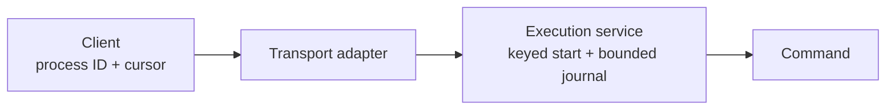
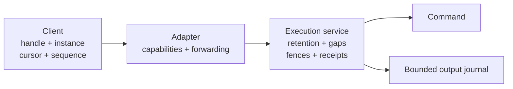

# Process replay and retry contracts

**Status: proposal.** Extend the existing process API for reconnecting terminals,
independent output readers and job runners. Keep commands, output and supervision
in one execution service; callers keep their handles and read positions.

This is independent of the [embedding contract](2026-10-06-guest-execution-embedding.md).
Embedding defines how an application hosts the service. This proposal defines
additional guarantees for its process clients, whether the service runs in a
guest daemon or an embedding application.

## Scope and implementation

| Primitive | Delivery |
| --- | --- |
| Configurable exit, output and completed-start retention | [Separate retention implementation](https://github.com/perplexityai/SPACE/pull/888). |
| Counted output gaps with opt-in replay | [Gap-recovery implementation](https://github.com/perplexityai/SPACE/pull/889). |
| Bind a start key to the request it identifies | Proposed; compatibility and request normalization need review. |
| Reject handles from an earlier engine lifetime | Proposed; discovery before the first start needs review. |
| Deduplicate process input, stdin closure and signals | Proposed; ordering, receipts and partial effects need review. |
| Capability discovery and end-to-end forwarding | Proposed; the gap implementation provides a connection acknowledgement, not complete discovery or external API exposure. |

The first two changes do not provide the remaining guarantees. Field names for
later changes are provisional; do not reserve wire numbers until implementation.
The [operation schema](../../../proto/spaced/operations/v1/operations.proto) is
the source of truth for existing field numbers and types.

## Before and proposed contract

Today, clients can retry a keyed start within its bounded lifetime and reconnect
from an output cursor. Retention is fixed, output can expire before the exit
record, and a lagging reader can fail or use `resume_from_oldest_retained` without
receiving an exact lost-byte count. Input and signal retries can repeat effects;
a process handle does not identify an engine lifetime.

Clients decide polling duration, output presentation and shell invocation. The
engine adds no Poll RPC, client registration, destructive read cursor, output
summary or automatic command rerun. Existing Process RPCs remain the operation
boundary; any discovery addition must use an explicitly reviewed metadata path.

## Retention

`ExecutionServiceConfig::process_retention` configures three independent windows:

| Window | Default | Meaning |
| --- | --- | --- |
| `completed` | 15 minutes | Keep the completed process record and exit. |
| `output` | 60 seconds | Keep completed output and environment, no longer than the record. |
| `idempotency` | 60 seconds | Keep completed keyed-start results. |

Each window must be nonzero and at most seven days. In-progress starts retain
their fixed 60-second bound. The existing record limits, output budgets and
eviction rules still apply: a longer window is not a reservation of capacity.
Record eviction can end reconnectability before the configured deadline. A key
record does not independently preserve the process's output.

Defaults preserve daemon behavior. For late output readers, configure both
`completed` and `output`; extending exit retention alone does not retain bytes.
These are in-memory, monotonic-clock windows, not persistence across restart.
Rust configuration changes follow the experimental crate-API policy.

## Output gaps

`ConnectProcess.resume_after_output_gap` opts into a `ProcessOutputGap` event
followed by retained output and, when available, the exit. The event contains:

- `skipped_events`: output events missed by this reader;
- `output_cursor`: the next output position the reader should use;
- `output_bytes_before`: cumulative stdout/stderr bytes before that position.

The reader advances its cursor for output events and replaces it with the gap's
cursor on a gap. Readers that track cumulative bytes can derive lost bytes from
`output_bytes_before`. Control events do not advance an output cursor. Several
readers can hold independent cursors; reads consume no shared client position.

The new option uses request field 5 and connection-acknowledgement field 2,
preserving `resume_from_oldest_retained` at field 4 and the existing connected
cursor at field 1. If both recovery options are enabled, the counted-gap option
takes precedence. Callers omitting it retain existing reconnect behavior.

The host checks acknowledgement on live connections and rejects an older guest
that does not confirm the option. Completed cursorless replay retains its
existing started/exit shape; it is not proof of capability support. Native and
compatibility endpoints do not opt in automatically. Full client exposure needs
explicit capability handling and forwarding at every intervening adapter.

Retrying a cursor is another read, not a promise that bytes remain forever:
eviction can turn a retry into a counted gap, and record expiry can make the
handle unavailable. A future cursor still fails rather than silently moving it.

## Remaining design decisions

### Bind start keys to requests

A key should identify one logical start: the same key and request replays the
result; a different request returns `InvalidArgument` before launching anything.
Define canonical equality over execution-affecting fields, including account,
argv, working directory, environment, timeout, PTY and requested process ID.
Map order must not matter. Resolve how omitted fields and changing configured
defaults participate before implementation; retries must not silently select a
different command because defaults changed.

Rejecting a changed request under an existing key changes today's behavior even
without a new field. Select an opt-in or an explicitly reviewed compatibility
policy before shipping this change. Key expiry still bounds deduplication.

### Fence engine lifetimes

Give each service lifetime an opaque `instance_id`. A supplied
`expected_instance_id` must be checked before keyed replay, lookup or effects on
Start, ConnectProcess, SendInput, CloseStdin and SendSignal. A mismatch returns
`FailedPrecondition`; it never runs the command again or resolves a reused ID in
the new lifetime. A fence is not authorization.

Returning the instance only in `ProcessStarted` is insufficient: the first reply
can be lost before the client learns it. A client requiring restart-safe starts
must discover the instance **before its first Start** and retain that expectation
on every retry. The metadata/discovery path and capability confirmation are
required design decisions. Without that handshake, an unfenced lost start has an
unknown outcome and must not be advertised as safe to retry across restart.

### Deduplicate process mutations

A proposed `sequence` on SendInput, CloseStdin and SendSignal identifies a
mutation within a fenced process lifetime. The service needs a bounded receipt
containing the operation, request identity and outcome. A matching duplicate
replays the receipt; conflicting reuse is rejected. Admission, registration,
side-effect ownership and receipt publication must remain ordered after caller
cancellation.

Before implementation, decide sequence ordering, concurrent-writer ownership,
receipt retention and behavior for expired, out-of-order or unknown sequences.
Do not acknowledge every lower number without checking its receipt. A partial
stdin write cannot be rolled back, and a signal acknowledgement does not prove
the target handled it. Preserve an explicit unknown/partial outcome when an
effect cannot be established; do not repeat an uncertain effect or call it an
exactly-once guarantee. Calls without a sequence retain existing behavior.

### Rollout and capability handling

Each guarantee needs discovery and confirmation appropriate to its operation.
Do not infer support from unknown protobuf fields being accepted. Older peers
must keep serving existing requests; opt-in requests must fail explicitly when
the required guarantee is unavailable. Preserve fields through every adapter,
and test mixed versions and rollback before enabling a feature for callers.

## Acceptance and delivery

Keep the embedding acceptance change independent. Deliver retention and gap
recovery as the two existing implementation changes; subsequent primitives need
their decisions above resolved in focused, separately reviewed changes.

| Area | Required evidence |
| --- | --- |
| Retention | Unchanged defaults; configured expiry of exit, output and keys; unchanged in-progress and capacity bounds. |
| Gaps | Exact counts under eviction/expiry; continued replay through exit; independent readers; legacy cursor/error behavior; older-peer rejection. |
| Key binding | Same-request replay, conflicting reuse, normalized maps/defaults, concurrent and cancelled starts. |
| Fencing | Restart between discovery and start, lost first reply, stale reconnect/mutation, reused process IDs and unsupported peers. |
| Mutation receipts | Lost replies, cancellation during effects, partial writes, duplicate/conflicting sequences, concurrency and bounded retention. |
| Adapters | End-to-end field preservation and capability failures; existing daemon/platform tests remain green. |

Retention and gap recovery are useful independently. Neither enables automatic
retry of unsequenced mutations or an unfenced start after an engine restart.
